<div align="center">

# 🌌 Nebula

**A dark, rounded and elegant theme for Jellyfin 12 and Emby**

Glass effect · violet → cyan gradient · smooth animations · featured carousel

**English** · [Español](README.es.md)


</div>

---

## ✨ Before and after

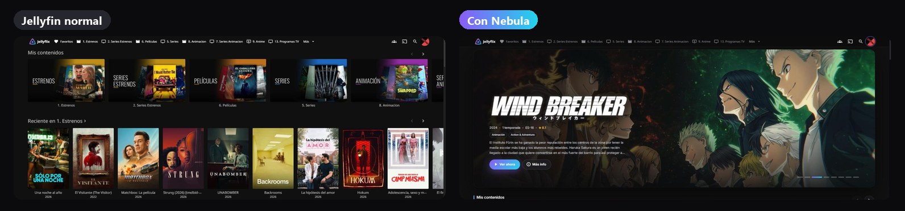

<table>
<tr>
<td width="50%">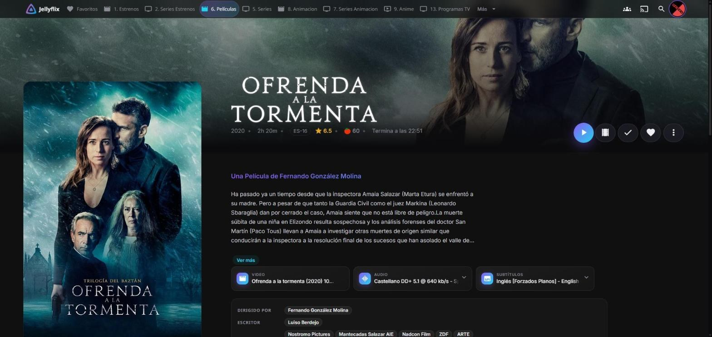<br><b>Movie page</b>: the logo replaces the title, round buttons, audio and subtitle tracks as cards.</td>
<td width="50%">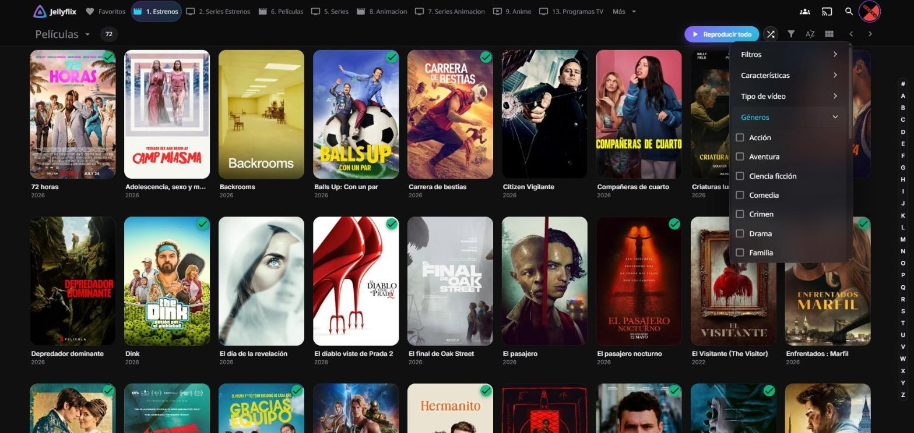<br><b>Library</b>: rounded cards, glass menus and clean filters.</td>
</tr>
<tr>
<td width="50%">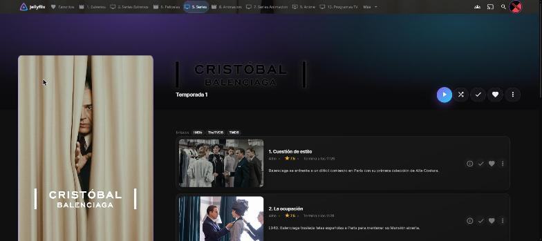<br><b>Episodes</b> as cards, with a "✓ Watched" badge and a short overview.</td>
<td width="50%" align="center">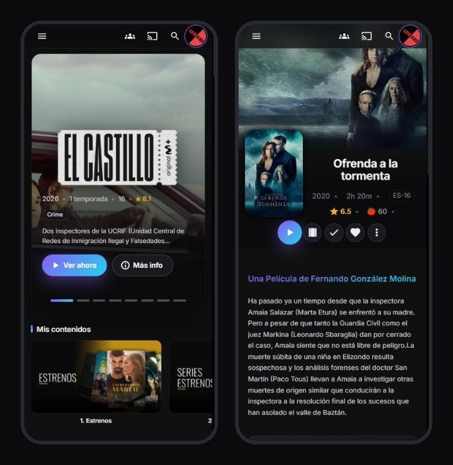<br><b>Mobile</b>: everything adapted to small screens.</td>
</tr>
</table>

**What changes, in short:**

| | |
|---|---|
| 🔘 **Everything rounded** | Cards, pill buttons, glass menus and dialogs, thin scrollbars, Inter font |
| 🎬 **Movie page** | Logo instead of title, animated entrance, custom audio/subtitle dropdowns, circular cast photos |
| 📺 **Episodes** | Cards with a play button on hover and a watched badge |
| ▶️ **Player** | Gradient pause button, glowing progress bar, glass "skip intro" |
| 🔐 **Everything else** | Login, search, TV guide, favorites and admin dashboard to match |
| 📱 **Mobile** | Adapted to narrow screens |

---

## 🚀 Installing the theme (1 minute, nothing to install)

> You only need to copy and paste **one line**. No files to touch, nothing to restart, and if you don't like it, removing it is just as easy.

**1.** Sign in to Jellyfin with an **administrator** account. Click your **user picture** (top right) → **Dashboard**.

**2.** In the left menu, open **Branding** (appearance customization).

**3.** In the **"Custom CSS code"** box, paste this line:

```css
@import url('https://cdn.jsdelivr.net/gh/nemesbak/jellyfin-nebula@main/nebula.css');
```

**4.** Click **Save** at the bottom.

**5.** Reload the page with **Ctrl + F5** (Mac: **Cmd + Shift + R**). On mobile, close the app or tab and open it again.

Done! 🎉 It applies to **all users** and updates itself whenever I improve the theme.

> 💡 Also want the **big home carousel** (the image at the top)? It's at the end: [🎠 Featured carousel](#-featured-carousel-optional).

---

## 🎨 Options

Each option is **one more line** that you paste **below** the theme line, in the same "Custom CSS code" box (*Dashboard → Branding*). Combine as many as you like.

> The option file names are in Spanish — just copy them as they are.

### 🌈 Accent color

Swap the violet → cyan for another color. Use **only one** of these lines:

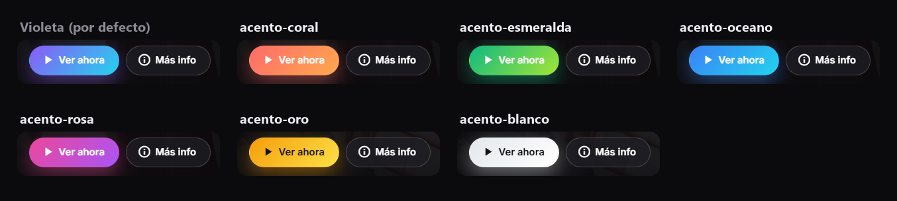

```css
@import url('https://cdn.jsdelivr.net/gh/nemesbak/jellyfin-nebula@main/opciones/acento-coral.css');
```

Replace `acento-coral` with the one you want: `acento-coral` (coral) · `acento-esmeralda` (emerald) · `acento-oceano` (ocean) · `acento-rosa` (pink) · `acento-oro` (gold) · `acento-blanco` (white).

<details>
<summary>🎛️ Want your own exact color?</summary>

Paste this below the theme and change the colors (each one as `#hex` and as `R,G,B` numbers):

```css
:root {
  --nb-a1: #ff6b6b; --nb-a1-rgb: 255,107,107;   /* color 1 */
  --nb-a2: #ffa94d; --nb-a2-rgb: 255,169,77;    /* color 2 */
  --nb-on-accent: #fff;                          /* text on buttons (use #111 if your colors are light) */
}
```
</details>

### 🧭 Top bar

Jellyfin 12 puts your libraries in the top bar. If you prefer a cleaner bar:

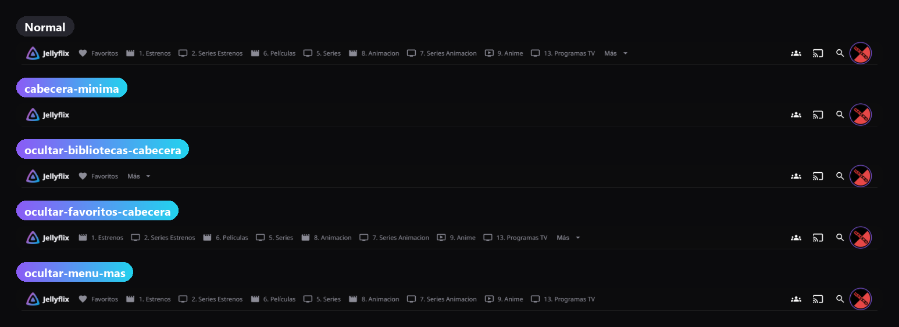

| I want… | Paste this line |
|---|---|
| A **minimal** bar (just logo, search and user) | `@import url('https://cdn.jsdelivr.net/gh/nemesbak/jellyfin-nebula@main/opciones/cabecera-minima.css');` |
| Hide only the **libraries** | `@import url('https://cdn.jsdelivr.net/gh/nemesbak/jellyfin-nebula@main/opciones/ocultar-bibliotecas-cabecera.css');` |
| Hide only **Favorites** | `@import url('https://cdn.jsdelivr.net/gh/nemesbak/jellyfin-nebula@main/opciones/ocultar-favoritos-cabecera.css');` |
| Hide only the **"More"** menu | `@import url('https://cdn.jsdelivr.net/gh/nemesbak/jellyfin-nebula@main/opciones/ocultar-menu-mas.css');` |

> You don't lose anything: libraries are still under "My Media" on the home page and in the ☰ menu.

### 🏷️ Text title instead of the logo

By default the item page shows the movie's **logo**. If you prefer the written name:

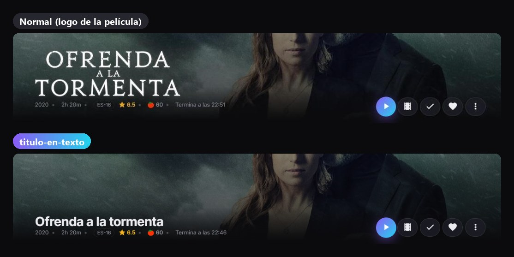

```css
@import url('https://cdn.jsdelivr.net/gh/nemesbak/jellyfin-nebula@main/opciones/titulo-en-texto.css');
```

### 🃏 Centered card text

Nebula left-aligns the title and year. To center them like stock Jellyfin:

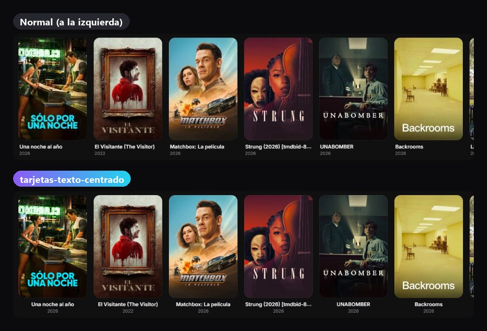

```css
@import url('https://cdn.jsdelivr.net/gh/nemesbak/jellyfin-nebula@main/opciones/tarjetas-texto-centrado.css');
```

### 🐢 No animations

For slow devices, TVs, or if you just don't like the effects. Everything appears instantly:

```css
@import url('https://cdn.jsdelivr.net/gh/nemesbak/jellyfin-nebula@main/opciones/sin-animaciones.css');
```

### 📋 Full example

This is what the box would look like with the theme + coral accent + minimal bar:

```css
@import url('https://cdn.jsdelivr.net/gh/nemesbak/jellyfin-nebula@main/nebula.css');
@import url('https://cdn.jsdelivr.net/gh/nemesbak/jellyfin-nebula@main/opciones/acento-coral.css');
@import url('https://cdn.jsdelivr.net/gh/nemesbak/jellyfin-nebula@main/opciones/cabecera-minima.css');
```

> ⚠️ `@import` lines must go **at the very top** of the box, before any other CSS you have.

---

## 📺 Nebula for Emby

Using **Emby**? Nebula is also available for Emby 4.9 / 4.10, with the same look and the same carousel.

<table>
<tr>
<td width="50%">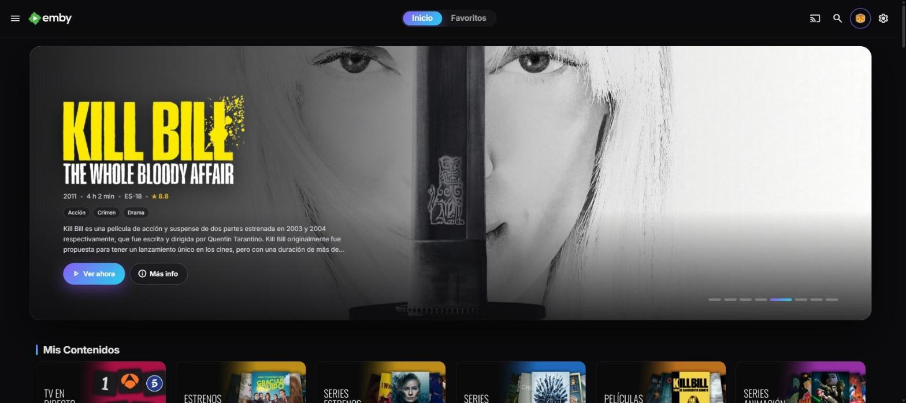<br><b>Home</b> with the featured carousel and pill tabs.</td>
<td width="50%"><br><b>Item page</b> with glass buttons, pill tracks and circular cast.</td>
</tr>
<tr>
<td width="50%">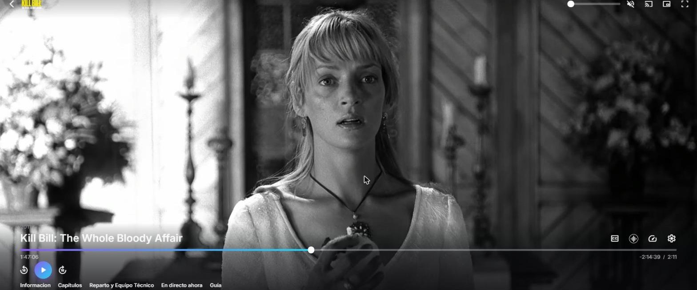<br><b>Player</b> with a gradient center button, violet→cyan progress bar and more readable controls.</td>
<td width="50%">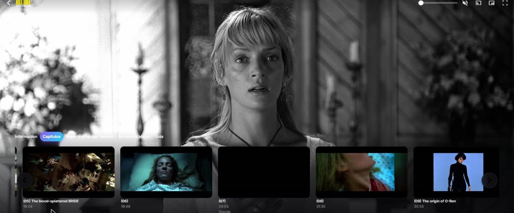<br><b>Chapters</b> and the other player tabs as pills.</td>
</tr>
</table>

**1. The theme (1 minute):** in Emby click the gear **⚙ (Manage Emby Server) → Dashboard → General**, and in **"Custom CSS"** paste:

```css
@import url('https://cdn.jsdelivr.net/gh/nemesbak/jellyfin-nebula@main/emby/nebula-emby.css');
```

Save and reload with **Ctrl + F5**.

**2. The carousel (optional):** installed with the **same command** as for Jellyfin ([see below](#-featured-carousel-optional)). The installer finds your Emby on its own (and your Jellyfin, if you have both).

> On Emby the carousel supports the same `--nb-hero-*` settings (paste them in "Custom CSS" below the `@import`). The files in `opciones/` are for the Jellyfin 12 top bar and don't apply to Emby.

---

## ❓ FAQ

<details>
<summary><b>I pasted the line and nothing changed</b></summary>

1. Make sure you clicked **Save**.
2. Reload with **Ctrl + F5** (the browser caches the old version).
3. Check that the line is the **first one** in the box, with no stray characters before it.
</details>

<details>
<summary><b>Does it work on my TV / phone app?</b></summary>

It works everywhere Jellyfin's **web client** is used: browsers (desktop and mobile), **Jellyfin Media Player** and the official **Android** app (which is the web client inside). "Native" apps like **Android TV, Swiftfin (iPhone/Apple TV) or Findroid** don't load custom CSS, so you won't see it there.
</details>

<details>
<summary><b>Do I need to update anything when you release improvements?</b></summary>

No. The line always points to the latest version. It can take a few hours to reach you because of caching; a **Ctrl + F5** helps.
</details>

<details>
<summary><b>Does it work with Jellyfin 10.x?</b></summary>

It's built for **Jellyfin 12**. On 10.x it partly works (the top bar and settings pages are different in 12).
</details>

<details>
<summary><b>How do I remove it?</b></summary>

Delete the lines from the "Custom CSS code" box (*Dashboard → Branding*), save and reload. Jellyfin goes back to how it was. (If you installed the carousel, see [how to remove it](#-removing-the-carousel).)
</details>

---

## 🎠 Featured carousel (optional)

The carousel is the **big image on the home page** that rotates on its own: recent titles you haven't watched yet, with their logo, year, rating, genres, overview and two buttons: **Play now** and **More info**. It pauses on hover, and on mobile you can swipe it.

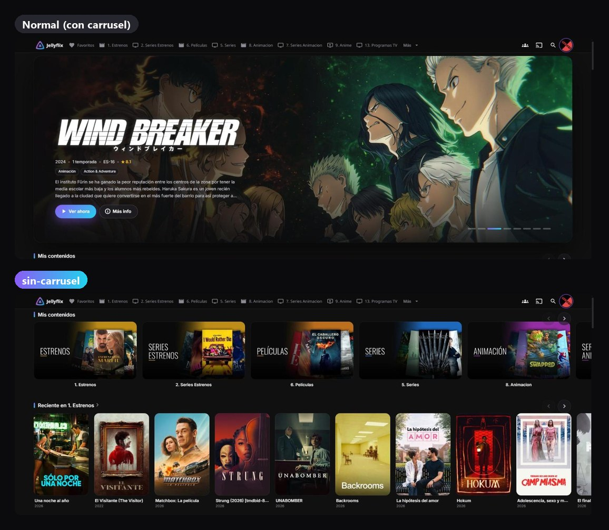

> 🤔 **Why is it separate?** Jellyfin only allows CSS (colors and shapes). The carousel is a small program (JavaScript), and adding it requires giving Jellyfin permission once. As a bonus, it also applies the theme to the **admin dashboard**, which ignores custom CSS in Jellyfin 12.

### ⚡ Install: one command

Open a **terminal on the machine where Jellyfin or Emby runs**, paste this and press Enter:

```bash
curl -fsSL https://raw.githubusercontent.com/nemesbak/jellyfin-nebula/main/install/nebula.sh | bash
```

Reload Jellyfin/Emby with **Ctrl + F5**. That's it! 🎉

The installer does everything by itself:
- 🔍 **Finds** all your Jellyfin and Emby servers, whether in Docker or installed directly. You don't need to know what anything is called.
- 🎠 **Adds** the carousel to each one.
- 🔁 **Re-adds it** automatically when you update Jellyfin/Emby (updates wipe it) and after a server reboot.

> The installer's messages are in Spanish, but there's nothing to answer — it runs on its own.

#### 📍 Where do I paste the command?

| I have… | Where the terminal is |
|---|---|
| 🟠 **Unraid** | Top right, the **`>_`** icon (Terminal). Paste and done. |
| 🟤 **Proxmox** (LXC or VM) | Paste it **inside** the LXC or VM where Jellyfin/Emby runs: select it in the left list → **Console**. *Not* in the Proxmox host shell. |
| 🐳 **Docker on Linux** (Ubuntu, Debian, Raspberry Pi…) | Any terminal or SSH. If it asks for permissions, use `… \| sudo bash`. |
| 🔵 **Synology / QNAP** | Enable **SSH** (Synology: *Control Panel → Terminal & SNMP*), log in with PuTTY or a terminal, type `sudo -i` and paste. |
| 🐧 **Jellyfin/Emby installed without Docker** (Debian, Ubuntu, *helper-scripts* LXC…) | That machine's terminal, with `sudo` if you're not root: `curl -fsSL https://raw.githubusercontent.com/nemesbak/jellyfin-nebula/main/install/nebula.sh \| sudo bash` |

<details>
<summary>🐳 I use Docker Compose or Portainer (if you don't know what this is, skip it)</summary>

**What is this?** It's **another way to install the same thing**. If you set up Jellyfin or Emby with a `docker-compose.yml` file, or from **Portainer**, you may prefer to keep Nebula in that same file alongside everything else. If none of this rings a bell, **you don't need it**: use the command above.

**What does it do?** It creates a tiny container called `nebula` that acts as a "helper": it finds your Jellyfin and Emby, adds the carousel, and if an update removes it, adds it back on its own.

#### 📝 With a `docker-compose.yml` file

1. Open your `docker-compose.yml` (the same one where Jellyfin or Emby is).
2. Find the `services:` line. Below it you'll see your apps (e.g. `jellyfin:`).
3. Paste this **at the end of the file**, keeping the leading spaces:

   ```yaml
     nebula:
       image: docker:cli
       container_name: nebula
       restart: unless-stopped
       volumes:
         - /var/run/docker.sock:/var/run/docker.sock
       entrypoint: ["sh", "-c", "apk add -q --no-cache bash curl && curl -fsSL https://raw.githubusercontent.com/nemesbak/jellyfin-nebula/main/install/inject-docker.sh | bash -s -- auto --watch"]
   ```

   > ⚠️ Indentation matters: `nebula:` must be **aligned** with `jellyfin:` (or your other apps' names).

4. Save the file and, in a terminal in that same folder, run:
   ```bash
   docker compose up -d
   ```
5. Reload Jellyfin/Emby with **Ctrl + F5**. Done!

#### 🧭 With Portainer

1. Open Portainer → **Stacks** → **＋ Add stack**.
2. In **Name** type `nebula`.
3. In the big box (**Web editor**) paste this as is:

   ```yaml
   services:
     nebula:
       image: docker:cli
       container_name: nebula
       restart: unless-stopped
       volumes:
         - /var/run/docker.sock:/var/run/docker.sock
       entrypoint: ["sh", "-c", "apk add -q --no-cache bash curl && curl -fsSL https://raw.githubusercontent.com/nemesbak/jellyfin-nebula/main/install/inject-docker.sh | bash -s -- auto --watch"]
   ```

4. At the bottom, click **Deploy the stack**.
5. Reload Jellyfin/Emby with **Ctrl + F5**. Done!

**To remove it:** in Portainer, delete the `nebula` stack. With the file, delete those lines and run `docker compose up -d --remove-orphans`. Then paste the [remove the carousel](#-removing-the-carousel) command to clean up Jellyfin/Emby.

<details>
<summary>🤓 For the curious: what each line means</summary>

- `image: docker:cli` → an official, very small Docker image.
- `container_name: nebula` → the name you'll see in your container list.
- `restart: unless-stopped` → starts on its own when you reboot the server.
- `volumes: …docker.sock…` → lets it "see" your other containers so it can put the carousel inside Jellyfin/Emby. That's why you don't need to tell it their names.
- `entrypoint: …` → on start, downloads the installer from this repository and keeps checking every 10 minutes.

Want it to apply the theme too? Add these lines below `restart:`, with your API key (only for the server you have):
```yaml
    environment:
      - JELLYFIN_API_KEY=your_key
      - EMBY_API_KEY=your_key
```
</details>
</details>

<details>
<summary>🎁 Extra: let it apply the theme too</summary>

With your API key, the installer also pastes the theme line into "Custom CSS" (only if it isn't there yet; it never deletes what you have):

1. Create a key: Jellyfin → *Dashboard → API Keys → ＋* · Emby → *Dashboard → API Keys → New*.
2. Paste the command like this, with your key (only for the server you have):
   ```bash
   curl -fsSL https://raw.githubusercontent.com/nemesbak/jellyfin-nebula/main/install/nebula.sh | JELLYFIN_API_KEY=your_key EMBY_API_KEY=your_key bash
   ```
3. Optional, Jellyfin only: add `NEBULA_OPTIONS=acento-coral,cabecera-minima` before `bash`.
</details>

<details>
<summary>🧩 No terminal: "JavaScript Injector" plugin (Jellyfin only)</summary>

1. Install a JavaScript injection plugin for Jellyfin (e.g. **JavaScript Injector**) from *Dashboard → Plugins → Catalog*. If it's not listed, first add its repository following the plugin's own instructions.
2. Restart Jellyfin.
3. On the plugin's page, create a new script and paste the contents of [`install/cargador.js`](install/cargador.js).
4. Save and reload with **Ctrl + F5**.
</details>

<details>
<summary>🛠️ Manually (advanced)</summary>

Copy [`nebula-home.js`](nebula-home.js) (Emby: [`emby/nebula-emby-home.js`](emby/nebula-emby-home.js)) into the web folder (Jellyfin: `jellyfin-web` · Emby: `dashboard-ui`) and add this right before `</body>` in its `index.html`:

```html
<script defer src="nebula-home.js"></script>
```

> Updates overwrite `index.html`: you'll have to redo this after each one (the command above does it for you).
</details>

### 🎛️ Customizing the carousel

Configured from the **same "Custom CSS code" box**, below the theme lines. Only add what you want to change:

| Setting | What it does | Default |
|---|---|---|
| `--nb-hero-count` | How many titles are shown (`0` = no carousel) | `8` |
| `--nb-hero-interval` | Seconds per slide (`0` = doesn't auto-advance) | `8` |
| `--nb-hero-source` | Where titles come from: `recent` · `toprated` · `random` · `favorites` (each user's favorites) | `recent` |
| `--nb-hero-types` | `"Movie"`, `"Series"` or both | `"Movie,Series"` |
| `--nb-hero-library` | Only these libraries, by name: `"Movies"` or `"Movies,Anime"` | all |
| `--nb-hero-days` | With `recent`: added in the last N days (`0` = no limit) | `120` |
| `--nb-hero-unwatched` | `1` = only things you haven't watched yet | `1` |
| `--nb-hero-logo` | `1` = only titles with a logo · `0` = also without (shows the name as text) | `1` |
| `--nb-hero-overview` / `-genres` / `-rating` | Show overview / genres / rating (`1` yes, `0` no) | `1` |
| `--nb-hero-buttons` | "Play now" and "More info" buttons | `1` |
| `--nb-hero-play` | `1` = "Play now" starts playback · `0` = just opens the item page | `1` |
| `--nb-hero-height` | Height on desktop | `min(68vh, 640px)` |
| `--nb-hero-height-mobile` | Height on mobile | `62vh` |

**Examples** (copy the one you like):

```css
/* The 10 top-rated from the "Movies" library, changing every 12 seconds */
:root { --nb-hero-count: 10; --nb-hero-source: toprated; --nb-hero-library: "Movies"; --nb-hero-interval: 12; }
```

```css
/* Random series only, no overview and shorter */
:root { --nb-hero-types: "Series"; --nb-hero-source: random; --nb-hero-overview: 0; --nb-hero-height: 50vh; }
```

```css
/* Each user's favorites (even if already watched) */
:root { --nb-hero-source: favorites; --nb-hero-unwatched: 0; }
```

> Just want to hide the carousel for a while without uninstalling it? Paste `@import url('https://cdn.jsdelivr.net/gh/nemesbak/jellyfin-nebula@main/opciones/sin-carrusel.css');`

### 🧹 Removing the carousel

Paste this in the same terminal where you installed it:

```bash
curl -fsSL https://raw.githubusercontent.com/nemesbak/jellyfin-nebula/main/install/nebula.sh | bash -s -- --uninstall
```

It removes the carousel from all your Jellyfin/Emby servers, plus the container or task that was watching it. The theme (CSS) is left untouched. If you installed it with **Compose**, also delete the `nebula` service from your file. If you used the plugin, delete the script there.

---

<div align="center">

Made with 💜 for the Jellyfin community · [MIT](LICENSE) License

If you like it, ⭐ star the repository — it really helps!

</div>
